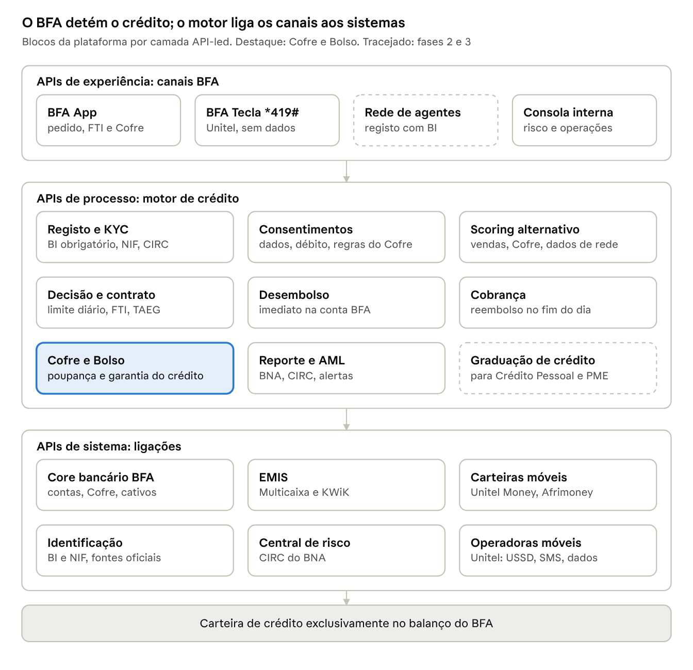
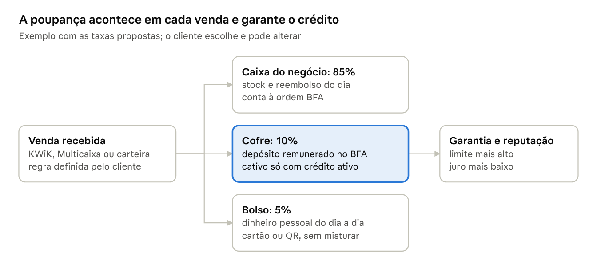

# Modelo de Negócio Recomendado: Microcrédito Digital em Angola

Nov 19, 2026 · @Nuno Esculcas

## Síntese

Recomenda-se um modelo **liderado pelo BFA**: o banco concede, regista e detém todos os empréstimos, e um motor de crédito ligado ao BFA App, ao BFA Tecla e às redes de pagamento faz a identificação, o scoring, a decisão e a cobrança.

- **Produto:** crédito diário até ao equivalente a USD 100 (cerca de Kz 91 000), reembolsado automaticamente a partir das vendas recebidas no próprio dia.
- **Cofre:** poupança automática em cada venda que serve de garantia, constrói reputação e dá acesso a juros mais baixos.
- **KYC:** BI obrigatório. Reduz o mercado inicial (42% da população tem BI), mas alinha o produto com a formalização que o Governo pretende.
- **Vantagem do BFA:** a Unitel, maior acionista do BFA (36,9%), opera a rede móvel e a Unitel Money; o BFA Tecla \*419# já funciona em qualquer telemóvel Unitel, sem dados.
- **Economia:** o juro de um empréstimo diário é de dezenas de kwanzas. O valor está na frequência de uso, nos depósitos do Cofre e na graduação dos clientes para crédito maior.
- **Entrega:** a equipa interna do BFA lidera; a implementação externa está por selecionar.

Assume-se que "diário" significa prazo de um dia, com reembolso no fim do dia. A leitura legal deste documento é um contributo técnico para o desenho do produto e deve ser confirmada pelos serviços jurídicos do BFA.

## Decisões do BFA

As seis decisões fecham as principais questões em aberto e simplificam o modelo: um banco, um credor, um produto de entrada.

| Decisão | O que muda no desenho |
| --- | --- |
| **Banco-âncora: [BFA](https://www.bfa.ao/)** | Segunda maior instituição financeira de Angola, cotada na BODIVA desde setembro de 2025. Acionistas no fim de 2025: Unitel 36,9%, BPI 33,35%, Congolian Financial 7,61%, minoritários 22,14%. Canais existentes: BFA App e BFA Tecla \*419# |
| **Carteira só no BFA** | Saem as sociedades de microcrédito e a plataforma multi-credor. O BFA empresta ao abrigo da Lei 14/21, pelo que o Decreto 89/23 deixa de ser o regime aplicável |
| **Projeto liderado pela equipa interna, com outsourcing** | O BFA detém produto, risco e conformidade; um implementador externo, por selecionar, constrói a camada de integração (ver Modelo de entrega) |
| **Crédito diário até USD 100** | Limite definido em kwanzas; preço ao dia, sem comissões fixas; FTI e TAEG apresentadas digitalmente antes da aceitação (Aviso 14/16) |
| **KYC com BI obrigatório** | Contas sem BI (Tipo I) não dão acesso a crédito; base inicial menor, mas cada cliente fica identificado, com NIF e consulta à CIRC |
| **Cofre como garantia, reputação e juro mais baixo** | Parte do saldo fica cativa enquanto houver crédito em curso; níveis de reputação definem limite e taxa |

A relação com a Unitel é a maior vantagem e o maior ponto de atenção: dados de rede e da Unitel Money exigem consentimento do cliente e cumprimento das regras do BNA sobre partes relacionadas.

## Modelo de negócio

O BFA detém a licença, o risco, os depósitos e a relação com o cliente. O crédito diário é a porta de entrada; a receita vem sobretudo do que ele traz para dentro do banco.

| Fonte de valor para o BFA | Como surge | Peso esperado |
| --- | --- | --- |
| Juro do crédito diário | Taxa anual aplicada aos dias de uso, sem comissões fixas | Baixo por empréstimo, relevante pela frequência |
| Depósitos do Cofre | Poupança automática em cada venda, depósito estável e de baixo custo | Alto: é o motor económico do modelo |
| Fluxos de pagamento | Vendas recebidas por KWiK, Multicaixa e Unitel Money passam pela conta BFA | Médio: comissões e saldo médio |
| Graduação de clientes | Quem constrói reputação passa para Crédito Pessoal, crédito PME e seguros | Alto a prazo |
| Inclusão e reputação institucional | Contributo para a ENIF e para a formalização pela via do BI | Estratégico |

**O que pagam os outros intervenientes**

- **Cliente:** juro ao dia, apresentado como custo total e TAEG antes de aceitar.
- **Implementador externo:** recebe honorários de implementação e de suporte; não assume risco de crédito.
- **Unitel e Unitel Money:** distribuição, canal USSD e dados com consentimento, em condições de mercado, por serem parte relacionada.

**Porquê esta estrutura**

- Sem nova licença nem capital adicional: o BFA usa a licença bancária que já tem.
- O Cofre fica no balanço do BFA, como depósito, o que nenhum credor não bancário pode fazer.
- O BFA Tecla e a base de clientes Unitel dão distribuição imediata, sem depender de terceiros.

## Blocos da plataforma

A plataforma tem três camadas: os canais com a marca BFA, o motor de crédito com as regras do produto, e as ligações aos sistemas do BFA e dos parceiros.



Os pedidos descem dos canais para o motor, que chama os sistemas; nenhum canal fala diretamente com o core bancário. O Cofre e Bolso é a funcionalidade nova, e a graduação de crédito entra na fase 3.

## Detalhe dos blocos

Cada bloco é uma API reutilizável: os de sistema ligam-se uma vez a cada sistema, os de processo concentram as regras do produto e os de experiência servem a App e o USSD com as mesmas regras.

| Bloco | Camada | O que faz | Regra ou parâmetro-chave | Fase |
| --- | --- | --- | --- | --- |
| BFA App | Experiência | Pedido, simulação com FTI e TAEG, aceitação, gestão do Cofre e do Bolso | Usa as mesmas APIs que o USSD | 1 |
| BFA Tecla \*419# | Experiência | Pedido e reembolso em qualquer telemóvel, sem dados | Hoje só para números Unitel; FTI enviada por SMS | 1 |
| Rede de agentes | Experiência | Registo assistido com BI, entrada e saída de numerário | O agente regista, nunca decide o crédito | 2 |
| Consola interna | Experiência | Risco, operações e reclamações | Acesso por perfis; trilho de auditoria | 1 |
| Registo e KYC | Processo | Verifica BI e NIF, abre ou associa a conta BFA, faz a triagem AML | BI obrigatório; contas Tipo I excluídas do crédito | 1 |
| Consentimentos | Processo | Regista autorizações de dados, débito automático e regras do Cofre | Finalidade, data e revogação; dados Unitel só com consentimento | 1 |
| Scoring alternativo | Processo | Calcula o risco com vendas recebidas, histórico do Cofre e dados de rede | Modelos versionados; consulta à CIRC (Aviso 14/16, art. 6.º) | 1 |
| Decisão e contrato | Processo | Define limite diário e taxa pelo nível de reputação; gera FTI, contrato e OTP | Limite em kwanzas até ao equivalente a USD 100; FTI e TAEG antes da aceitação | 1 |
| Desembolso | Processo | Credita a conta BFA de imediato | Transferência interna ou KWiK | 1 |
| Cobrança | Processo | Reembolso automático no fim do dia a partir das vendas recebidas | Compensação sobre a parte cativa do Cofre só em incumprimento | 1 |
| Cofre e Bolso | Processo | Reparte cada venda; gere a parte cativa e os níveis de reputação | Taxas escolhidas pelo cliente; parte cativa libertada no reembolso | 1 |
| Reporte e AML | Processo | Reporte ao BNA e à CIRC, monitorização de transações | Alertas para revisão humana | 1 |
| Graduação de crédito | Processo | Propõe Crédito Pessoal ou crédito PME a quem atinge o nível máximo | Regras de elegibilidade do BFA | 3 |
| Core bancário | Sistema | Contas, Cofre, cativos e contabilização dos empréstimos | Integração por API, sem alterar o core | 1 |
| EMIS | Sistema | Multicaixa e KWiK: vendas recebidas e histórico | Liquidação em kwanzas | 1 |
| Unitel Money e outras carteiras | Sistema | Recebimento de vendas e distribuição a não clientes | Parte relacionada: condições de mercado | 2 |
| Identificação | Sistema | Validação de BI e NIF junto das fontes oficiais | Disponibilidade de API a confirmar | 1 |
| Central de risco | Sistema | Consulta e reporte à CIRC | Regras para micro-montantes a confirmar | 1 |
| Operadoras móveis | Sistema | USSD, SMS e dados de rede com consentimento | Unitel na fase 1; outras operadoras na fase 3 | 1 e 3 |

## Cofre e Bolso: poupança que garante o crédito

O Cofre tem três funções: poupança automática, garantia do crédito diário e reputação que baixa o juro. Como o empréstimo é de um dia, a parte cativa fica presa apenas algumas horas.



Com as taxas propostas, uma venda de 10 000 Kz põe 1 000 Kz no Cofre, 500 Kz no Bolso e deixa 8 500 Kz no negócio.

**Como funciona**

1. O cliente adere de forma explícita, com BI, e escolhe as taxas de poupança.
2. Cada venda recebida (KWiK, Multicaixa ou Unitel Money) entra na conta BFA e a regra reparte-a de imediato.
3. Ao pedir crédito, uma parte do saldo do Cofre fica cativa, na proporção definida pelo nível do cliente.
4. No fim do dia, as vendas reembolsam o empréstimo e a parte cativa é libertada.
5. Em incumprimento, o BFA compensa sobre a parte cativa, nos termos do contrato, e só depois aplica a cobrança normal.

**Níveis de reputação** (proposta; parâmetros a calibrar com os dados do piloto)

| Nível | Condição de acesso | Limite diário | Taxa | Parte cativa do Cofre |
| --- | --- | --- | --- | --- |
| Entrada | BI validado e Cofre ativo | Mais baixo | Taxa de referência | Maior |
| Confiança | Reembolsos sem atraso e saldo do Cofre a crescer | Intermédio | Reduzida | Intermédia |
| Pleno | Histórico longo e Cofre acima do patamar definido | Até ao equivalente a USD 100 | Mais baixa | Menor |

**Ajustes à proposta original**

| Proposta original | Ajuste | Porquê |
| --- | --- | --- |
| 10% e 5% fixos em cada transação | Taxas escolhidas pelo cliente, aplicadas só a vendas recebidas; começar baixo e subir até 10% | Retirar 15% das vendas brutas pode exceder a margem de um comerciante |
| "Cold wallet" e "hot wallet" | Cofre e Bolso | São termos de criptoativos, sobre os quais o BNA tem emitido alertas |
| Poupança bloqueada | Saldo livre levantável a qualquer momento; só a parte cativa fica presa, e só enquanto houver crédito | O comerciante precisa de liquidez imediata |

**Salvaguardas**

- **Transparência:** a garantia consta da FTI e do contrato, e cada repartição aparece no extrato.
- **Proporcionalidade:** nunca fica cativo mais do que o crédito em curso.
- **Remuneração:** com inflação de 8,16% em outubro de 2026, uma taxa real positiva torna o Cofre fácil de comunicar; a taxa é decisão do BFA.
- **Forma jurídica:** cativo, penhor financeiro ou compensação contratual, a definir pelos serviços jurídicos do BFA.

## Preço do crédito diário e enquadramento regulamentar

Um empréstimo de um dia só é viável com preço ao dia e custo de servir quase nulo: qualquer comissão fixa faz disparar a TAEG.

**Limite em kwanzas.** USD 100 equivalem a cerca de Kz 91 200, ao câmbio de cerca de 912 Kz/USD, praticamente estável desde 2025 (a confirmar à data de lançamento). Recomenda-se fixar o limite em kwanzas, por exemplo Kz 90 000, porque o preçário e a liquidação Multicaixa são em kwanzas (Aviso 5/17).

**A aritmética do dia**

| Exemplo | Cálculo | Resultado |
| --- | --- | --- |
| Juro de Kz 90 000 por um dia a 24,5% ao ano (taxa de um crédito pessoal do BFA) | 90 000 × 24,5% ÷ 365 | Cerca de Kz 60 |
| Comissão fixa de Kz 500 no mesmo empréstimo | 500 ÷ 90 000 × 365 | Equivale a cerca de 203% ao ano |
| Comissão de abertura atual do Crédito Pessoal BFA | 2%, mínimo Kz 120 000 | Maior do que o próprio empréstimo |

O crédito diário precisa, por isso, de uma linha própria no preçário e de uma FTI própria, só com juro ao dia. Com hipóteses ilustrativas, um cliente que use o crédito 20 dias por mês gera cerca de Kz 1 200 de juro; se vender Kz 600 000 por mês e guardar 5% no Cofre, deposita Kz 30 000 por mês. O Cofre vale mais do que o juro.

**Regra de preço**

```math
\text{preço} \geq \text{custo de financiamento} + \text{perda esperada} + \text{custo de servir} + \text{margem}
```

- **Custo de financiamento:** ancorado na taxa BNA de 14% (17 de novembro de 2026) e reduzido pelos depósitos do Cofre.
- **Perda esperada:** a garantia do Cofre reduz-a, o que justifica taxas mais baixas nos níveis de reputação superiores.
- **Imposto do Selo:** o preçário do BFA indica isenção para créditos até 5 dias, o que favorece o crédito diário (a confirmar com a área fiscal).

**Regras do BNA que moldam o produto**

| Regra | Consequência no desenho |
| --- | --- |
| Aviso 14/16, art. 5.º e 7.º: FTI na simulação e na aprovação, sem alterar campos | FTI digital na App; no USSD, resumo no ecrã e FTI completa por SMS |
| Aviso 14/16, art. 3.º e 8.º: a TAEG inclui juros, comissões, impostos e seguros | TAEG mostrada antes de cada aceitação |
| Aviso 14/16, art. 6.º: avaliação de solvabilidade com consulta à CIRC | Consulta automática na decisão |
| Aviso 14/16, art. 10.º: livre revogação de 15 dias no crédito ao consumo | Definir se o produto é crédito ao consumo ou crédito à atividade do comerciante |
| Aviso 14/16, art. 14.º, n.º 5: reestruturação sem aumento de encargos | Plano de reestruturação sem custos adicionais |
| Aviso 5/17: preçário e liquidação Multicaixa em kwanzas | Limite e preço definidos em kwanzas |

O Decreto Presidencial 89/23 regula sociedades e operadores de microcrédito; como o BFA empresta com a sua licença bancária, serve apenas de referência de mercado. Em agosto de 2026 o BNA identificou nove credores digitais não autorizados: uma app com a marca BFA fica do lado certo dessa linha.

## Faseamento

Cada fase só avança quando o critério de passagem anterior estiver cumprido.

1. **Piloto com clientes BFA.** Clientes com BI e números Unitel, pelo BFA App e pelo BFA Tecla \*419#; Cofre obrigatório para aceder ao crédito; limites baixos no nível Entrada; reembolso automático no fim do dia. *Passagem:* incumprimento por coorte dentro do apetite de risco e adesão ao Cofre acima da meta definida pelo BFA.
2. **Não clientes via Unitel Money e agentes.** Abertura de conta BFA com BI no registo, desembolso sempre para a conta BFA; agentes para registo assistido. *Passagem:* acordo de dados com a Unitel aprovado pela conformidade (parte relacionada) e contribuição positiva por coorte.
3. **Escala e graduação.** BFA Tecla aberto a outras operadoras, graduação dos clientes de nível Pleno para Crédito Pessoal e crédito PME, e campanhas conjuntas de emissão de BI. *Passagem:* qualidade da carteira estável na escala da fase 2.

## Modelo de entrega

O BFA detém as decisões e as regras; o implementador externo constrói e transfere. A escolha do implementador está em aberto.

| Área | Equipa interna do BFA | Implementador externo |
| --- | --- | --- |
| Produto, preço e níveis do Cofre | Decide e aprova | Configura como parâmetros |
| Risco e modelos de scoring | Define política e valida modelos | Constrói os fluxos de dados e o motor de regras |
| Conformidade, BNA e jurídico | Responsável único | Implementa trilhos de auditoria, FTI e reportes |
| Integração com core, EMIS, Unitel e CIRC | Disponibiliza acessos e ambientes | Constrói e testa as APIs de sistema e de processo |
| BFA App e BFA Tecla | Dono dos canais | Expõe as APIs e apoia a integração nos canais |
| Operação e suporte | Opera após a passagem | Suporte com níveis de serviço acordados no arranque |
| Código e conhecimento | Proprietário do código e da documentação | Transfere conhecimento à equipa interna |

**Critérios para escolher o implementador**

1. Experiência comprovada em integração API-led com core bancário, EMIS e canais USSD.
2. Presença ou parceiros em Angola e conhecimento das regras do BNA.
3. Segurança: gestão de segredos, cifragem e trilhos de auditoria desde o primeiro dia.
4. Transferência de conhecimento e código propriedade do BFA.
5. Modelo de preço claro, sem dependência de licenças proprietárias do implementador.

A Ampleshift pode candidatar-se como implementador da camada de integração; este documento mantém-se neutro quanto à escolha.

## Questões em aberto

As decisões do BFA fecharam as questões de banco, carteira e KYC. Ficam estas, a fechar antes da produção.

1. **Prazo:** "diário" é sempre um dia, com reembolso no fim do dia, ou um limite disponível todos os dias com prazo até alguns dias?
2. **Regime do crédito:** crédito ao consumo ou crédito à atividade do comerciante? Muda a livre revogação de 15 dias e o conteúdo da FTI.
3. **Limite:** valor fixo em kwanzas (por exemplo Kz 90 000) ou revisto periodicamente face ao dólar?
4. **Cofre como garantia:** percentagem cativa por nível, remuneração e forma jurídica da garantia, com os serviços jurídicos do BFA.
5. **Unitel:** base legal e consentimento para usar dados de rede e da Unitel Money, e tratamento como parte relacionada.
6. **Imposto do Selo:** confirmar a isenção para créditos até 5 dias.
7. **Abertura de conta à distância:** regras do BFA para abrir conta só com BI, por USSD ou agente, na fase 2.
8. **Implementador:** processo de seleção, calendário e orçamento.
9. **BI:** interesse do BFA e do Governo em campanhas conjuntas de emissão de BI para alargar a base.

## Fontes

- [Análise completa em inglês: Rapyd, Decreto 89/23 e modelo de negócio](https://claude.ai/artifact/6S6TpqvDWZe5HAo8NawjoJ)
- [BFA: Relatório de Disciplina de Mercado 2025 (estrutura acionista)](https://www.bfa.ao/media/8625/bfa_relatorio-de-disciplina-de-mercado-2025.pdf)
- [Economia & Mercado: BFA protagoniza a maior operação do mercado de capitais em África (2025)](https://www.economiaemercado.com/artigo/retrospectiva-2025-bfa-protagoniza-a-maior-operacao-do-mercado-de-capitais-em-africa)
- [African Capital Markets News: IPO do BFA cinco vezes subscrito](https://africancapitalmarketsnews.com/success-with-5x-oversubscription-on-angolas-241m-ipo-share-offer/)
- [BFA: folheto BFA Tecla \*419# (março de 2026)](https://www.bfa.ao/media/8470/folheto-digital_bfa-tecla.pdf)
- [BFA: Preçário de Clientes Particulares (em vigor desde 15 de abril de 2026)](https://www.bfa.ao/media/8428/precario.pdf)
- [BFA: FTI do Crédito Solução BFA](https://www.bfa.ao/media/8050/fti-credito-solucao-bfa.pdf)
- [BFA: parceria com a IFC (16 de março de 2026)](https://www.bfa.ao/media/8310/bfa_parceria_comunicado_ifc.pdf)
- [LEX.AO: Aviso do BNA n.º 14/16, deveres de informação na concessão de crédito](https://lex.ao/docs/banco-nacional-de-angola/2016/aviso-n-o-14-16-de-07-de-setembro/)
- [LEX.AO: Aviso do BNA n.º 5/17, cartões de pagamento e subsistema Multicaixa](https://lex.ao/docs/banco-nacional-de-angola/2017/aviso-n-o-5-17-de-10-de-julho/)
- [LEX.AO: Decreto Presidencial n.º 89/23, de 31 de março](https://lex.ao/docs/presidente-da-republica/2023/decreto-presidencial-n-o-89-23-de-31-de-marco/)
- [Expansão: estabilidade do dólar nos 912 Kz (dezembro de 2025)](https://expansao.co.ao/angola/detalhe/estabilidade-do-dolar-confirma-gestao-administrativa-da-moeda-nacional-68864.html)
- [Expansão: BNA alerta para nove entidades de crédito ilegal (28 de agosto de 2026)](http://expansao.co.ao/empresas/detalhe/bna-emite-alerta-sobre-nove-entidades-de-credito-ilegal-74241.html)
- [VerAngola: BNA reduz a taxa de referência para 14% (novembro de 2026)](https://www.verangola.net/va/pt/112026/BancaSeguros/50806/BNA-reduz-taxa-de-referência-em-075-pontos-percentuais-para-14-por-cento.htm)
- [Expansão: inflação de 8,16% em outubro (13 de novembro de 2026)](https://expansao.co.ao/economia/detalhe/inflacao-homologa-volta-a-descer-e-fixa-se-em-apenas-816-em-outubro-76066.html)
- [Expansão: falta de BI e informalidade travam a inclusão financeira (15 de abril de 2025)](https://expansao.co.ao/angola/detalhe/falta-de-bi-baixa-escolaridade-e-alta-informalidade-bloqueiam-avanco-da-inclusao-financeira-64891.html)
- [Expansão: dezasseis empresas autorizadas a emitir moeda eletrónica (agosto de 2024)](https://www.expansao.co.ao/empresas/interior/dezasseis-empresas-autorizadas-pelo-bna-a-emitir-moeda-electronica-120961.html)
- [ANGOP via AllAfrica: nova etapa da Estratégia Nacional de Inclusão Financeira (9 de julho de 2026)](https://fr.allafrica.com/stories/202607100361.html)
