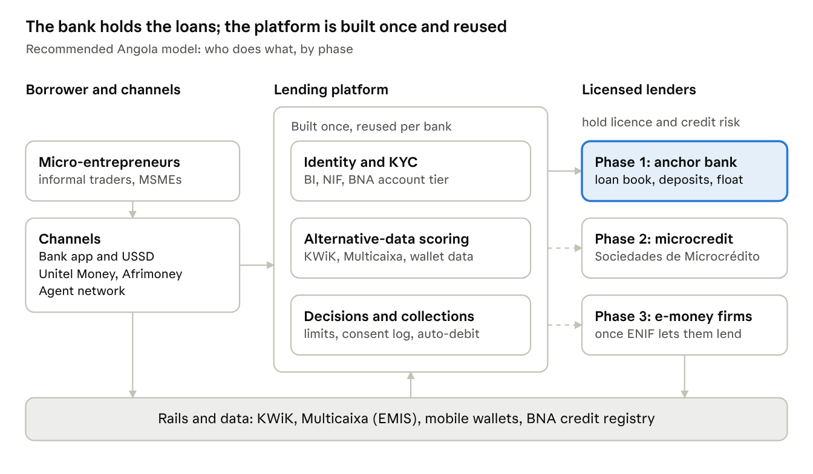

# Rapyd Executive Summary and Angola Micro-Loan Business Model

Nov 19, 2026 · @Nuno Esculcas

## Executive summary

Rapyd won by building regulated payment plumbing once and renting it to every business that wants to act like a fintech. For Angola, Decreto Presidencial 89/23 does not block a micro-loan app: it decides which licence can hold the loan book. The recommended model is **bank-led, platform-built**.

- **Rapyd in one line:** a London-headquartered, Israeli-founded Fintech-as-a-Service platform with one API for collections, payouts, wallets, card issuing and white-label lending. Revenue passed $1B after the $610M PayU GPO acquisition closed in March 2025. Profitable since 2024; valuation reset from about $15B (2022) to about $4.5B (2025).
- **Why it worked:** licences and local payment rails as the moat, enterprise customers in complex cross-border verticals, acquisitions that bought licences and merchant books, and AI aimed at a cost base that is 70% people.
- **Decreto 89/23 (31 March 2023):** the regulation for microcredit companies and operators. It requires BNA authorisation, bans deposit-taking, leaves rates free but lets BNA cap usurious ones, and delegates the small-loan ceiling to BNA.
- **Impact on an Angola app:** a bank such as BAI lends under its own licence (Lei 14/21), so 89/23 mainly shapes competitors, pricing-cap risk and the option of a separate vehicle. A standalone microcredit company could not hold deposits, which removes the float economics behind the Nkosuo thesis.
- **Recommendation:** the anchor bank books the loans; a reusable lending platform handles identity, scoring, decisioning and collections over KWiK, Multicaixa and mobile wallets. Later phases open the same engine to licensed microcredit companies and, once ENIF rules allow, to e-money issuers.

The legal reading here is a technical input for product design. Angolan counsel should confirm it before any build decision.

## Rapyd at a glance

Rapyd is a private, profitable payments infrastructure company of roughly 1,600 people, now past $1B in revenue and preparing for an IPO it has not yet filed.

| Item | Detail |
| --- | --- |
| Founded | 2015 as the CashDash consumer e-wallet; pivoted to B2B infrastructure in 2016 |
| Founders | Arik Shtilman (CEO), Arkady Karpman, Omer Priel |
| Base | Headquartered in London, founded and largely built in Israel |
| Positioning | "An AI-native fintech" that lets businesses accept payments, send payouts and embed financial services through one platform ([rapyd.net](https://www.rapyd.net/company/about/)) |
| Reach | Local payment and payout methods in 183 markets ([network page](https://www.rapyd.net/network/)); financial activity permits in 41 countries ([CTech](https://www.calcalistech.com/ctechnews/article/rjjmeyl3jl)) |
| Scale | About $100B processed in the year to Sept 2024; 250,000+ customers after PayU; about 1,600 staff after the March 2025 close |
| Revenue | Above $1B post-PayU ([CTech](https://www.calcalistech.com/ctechnews/article/rjjmeyl3jl)); about $1.1B guided for 2025 per [CoinLaw](https://coinlaw.io/rapyd-statistics/), citing the CEO |
| Profitability | "We moved to profitability this year" (CEO, Sept 2024, [CTech](https://www.calcalistech.com/ctechnews/article/t817yze6v)); "growing and profitable" (May 2026) |
| Funding | Over $1B raised from General Catalyst, Stripe, Target Global, Coatue, BlackRock, Fidelity and others |
| Valuation path | $2.5B (Jan 2021), $8.75B (Aug 2021), about $15B (2022 secondary), about $4.5B (Mar 2025, $500M raise) |
| Acquisitions | Korta, Iceland (2020); Valitor, Iceland (2021, about $100M); Neat, Hong Kong; PayU Global Payments Organisation from Prosus ($610M, closed March 2025) |
| Africa footprint | Nigeria and South Africa via PayU GPO ([press release](https://www.rapyd.net/company/news/press-releases/rapyd-completes-acquisition-of-payu-latin-america-and-africa/)); no mobile money rails shown on its site |

Figures come from company statements and trade press, not audited filings; sources disagree on founding year, 2021 valuation and headcount.

## Rapyd's business model

Rapyd sells regulated financial infrastructure as a service: a client integrates one API and inherits Rapyd's licences, local payment methods and compliance stack. Its own framing: "Everybody wants to be a fintech company. Nobody wants to build fintech infrastructure."

| Product line | What the client gets | How Rapyd earns |
| --- | --- | --- |
| Collect (online and in-store) | Checkout, payment links, card acquiring, POS terminals, hundreds of local payment methods | Percentage per transaction plus FX; Interchange++ with a fixed acquirer fee in global pricing; blended rates such as 3.49% in Chile ([pricing](https://www.rapyd.net/products/pricing/)) |
| Disburse | B2B, B2C and C2C payouts, domestic and cross-border, instant card payouts | Per-payout fees; entry requirements of 500+ monthly payouts and a $5K monthly minimum ([Contrary](https://research.contrary.com/company/rapyd)) |
| Wallet and accounts | Multi-currency business accounts, virtual accounts, ledger | Account fees (for example $99 per month in the UK and Hong Kong) plus FX spread |
| Issuing | Virtual and physical cards funded from wallets | Interchange share and programme fees |
| Embedded finance | White-label lending, stablecoin pay and settle | Revenue share with the platform that embeds it |

**Who buys:** enterprises supply about 75% of revenue. Target verticals are those where local payment methods decide conversion: marketplaces, iGaming, online travel, the creator economy, online trading, crypto on-ramps and B2B payments. Named clients include Uber, Adidas, Booking, Google, Meta and Microsoft.

**Channel:** direct enterprise sales plus a partner programme for ISOs, ISVs, PayFacs and referral agents, which resell the stack inside their own software.

## Why Rapyd succeeded, and the caveats

Rapyd's edge is the hard, slow work its clients refuse to do: licences, local rails and compliance in dozens of markets, sold back as one integration.

**Success factors**

1. **Licences and local rails as the moat.** Permits in 41 countries and hundreds of local methods are expensive to copy; Rapyd claims local methods can lift conversion by up to 30%.
2. **One stack, many revenue lines.** Collect, payout, wallet, issuing and lending on one ledger raise revenue per client and switching costs.
3. **Complex, high-margin verticals.** Cross-border marketplaces, iGaming and travel pay for coverage that generic acquirers lack.
4. **Acquisitions that buy licences and books.** Korta and Valitor added licensed card processing in Iceland and Europe; PayU GPO added Latin America, Africa and Europe plus about $300M to $350M of annual revenue.
5. **Operating leverage through AI.** With 70% of costs in personnel, the CEO targeted automating 70% of back-office work by 2026 and tripling EBITDA margins within three years ([CTech](https://www.calcalistech.com/ctechnews/article/t817yze6v)).
6. **Patient, top-tier capital.** Stripe and General Catalyst early, then growth funds, financed a multi-year licensing build.

**Caveats**

- **Valuation reset.** About $4.5B in 2025 is roughly 70% below the 2022 peak; IPO timing has moved from "two or three years" (2023) to "2026", and no filing has been reported.
- **Integration and restructuring.** Headcount swung from 850 to about 1,600 with PayU; in May 2026 the CEO declared Rapyd "a company operated by AI" and closed a department of dozens to over a hundred roles ([CTech](https://www.calcalistech.com/ctechnews/article/h1r00jfrgzl)).
- **Compliance-heavy client mix.** iGaming, trading and crypto on-ramps raise AML exposure; no enforcement actions appeared in the sources read.
- **Geopolitical exposure.** The CEO reported losing $15M to $20M of revenue from customers who left over Israel-related boycotts (Sept 2024).
- **Thin African coverage.** Nigeria and South Africa only, with no mobile money shown: Rapyd is not a ready rail for Angola or Ghana.

## Lessons for Nkosuo and an Angola version

The transferable lesson is structural: own the reusable infrastructure layer, and let licensed partners own the licence and the credit risk.

| Rapyd lesson | Translation for the micro-loan app |
| --- | --- |
| Build the regulated plumbing once, sell it many times | One lending engine (identity, scoring, decisioning, collections) deployed per bank: GCB Nkosuo in Ghana, BAI Kumbu in Angola, the neutral blueprint elsewhere |
| Partner with whoever holds the licence | The bank's licence carries the loan book; the platform stays a technical service provider |
| Local rails decide conversion | G-Money and MoMo in Ghana; KWiK, Multicaixa and Unitel Money or Afrimoney in Angola. Rapyd's own network does not cover these |
| Bundle around the core transaction | Disburse into the bank's account or wallet, collect from it, add savings: the loan becomes a deposit-acquisition tool |
| Automate the back office | Tickets of a few hundred dollars only pay if KYC, underwriting and collections are near-zero-touch |
| Avoid the valuation trap | Grow capital-light and per-deployment; do not buy scale through acquisitions before unit economics are proven |

## Decreto Presidencial 89/23: what it says

[Decreto Presidencial n.º 89/23, de 31 de Março](https://lex.ao/docs/presidente-da-republica/2023/decreto-presidencial-n-o-89-23-de-31-de-marco/) approves the *Regulamento das Sociedades de Microcrédito e Operadores de Microcrédito*. It was published in Diário da República I Série n.º 59 and has applied since 31 March 2023 (PLMJ dates it 1 April), revoked Decreto Presidencial n.º 28/11 and sits under Lei n.º 14/21, the general regime for financial institutions. [BNA Aviso n.º 4/23](https://lex.ao/docs/banco-nacional-de-angola/2023/aviso-n-o-4-23-de-28-de-junho/) sets the licensing procedure.

| Topic | Rule | Source |
| --- | --- | --- |
| Who it covers | *Sociedades de Microcrédito* (non-bank financial institutions) and *Operadores de Microcrédito* (commercial companies, NGOs, associations or foundations doing microcredit non-exclusively) | DP 89/23, Arts. 2 and 3 |
| Licence | Sociedades need prior BNA authorisation and a special-registry entry; Operadores only register with BNA | DP 89/23 Art. 4; Aviso 4/23 Arts. 4 and 8 |
| Capital | Minimum share capital set by a separate BNA normativo; a prior deposit of 5% of that minimum goes with the application | Aviso 4/23 Art. 3, Annex I |
| Deposits | Banned, except early repayments and cash pledged as loan collateral | DP 89/23 Art. 5 |
| Funding | Own funds; subordinated loans over 5 years count up to 50% of base resources; hybrid instruments allowed | DP 89/23 Arts. 7 and 8 |
| Interest | Freely negotiated; BNA may set and publish maximum rates where usury may arise | DP 89/23 Art. 9 |
| Loan size | "Empréstimos de pequenos montantes" to micro and small entrepreneurs, individual or group liability; ceiling defined by BNA | DP 89/23 Art. 3 |
| Governance and AML | Business plan with shareholder structure, risk, compliance, outsourcing; client acceptance, due diligence and suspicious-activity reporting | Aviso 4/23, Annex I |
| Supervision | Prudential and conduct supervision by BNA; BNA accounting standards | DP 89/23 Arts. 10 and 12 |

The decree says nothing about digital channels, mobile money or app-based lending. As of August 2026, BNA counted 22 microcredit companies and 25 registered operators ([Expansão](http://expansao.co.ao/empresas/detalhe/bna-emite-alerta-sobre-nove-entidades-de-credito-ilegal-74241.html)). The official PDF is a scanned image, so provisions above rest on LEX.AO and the [PLMJ / RVA note](https://www.plmj.com/xms/files/03_Novidades_legislativas/2023/abril/N_Colab_RVA-PLMJ_Microcredito.pdf).

## Impact on an Angola version of the app

The decree decides who may hold the loan book, and the answer favours a bank. Three legal vehicles are available:

| Vehicle | Licence path | Funding | Can hold deposits or wallet float | Fit for a scaled app |
| --- | --- | --- | --- | --- |
| **Bank lends on its own balance sheet** (for example BAI) | Existing banking licence under Lei 14/21; DP 89/23 does not apply to the bank itself | Deposits, at the bank's cost of funds | Yes | **Best**: fastest route, keeps the float |
| Sociedade de Microcrédito (new or bank-owned) | BNA authorisation, minimum capital, 5% prior deposit, special registry | Own funds, subordinated loans, hybrid instruments | No | Medium: useful for segments the bank will not book |
| Operador de Microcrédito | BNA registration only, non-exclusive activity | Sponsor's own resources | No | Low: suits NGO or pilot programmes |

**What changes in the product design**

- **Pricing must survive a cap.** Rates are free, but BNA can impose ceilings. Ghana's 3% to 4% flat monthly fee equals 36% to 48% a year, well above the 15% to 26% plus 3% to 8% commission that app lender Avança na Vida disclosed at licensing ([Forbes África Lusófona](https://forbesafricalusofona.com/?p=96845)). Copying Ghana pricing would invite usury scrutiny.
- **Ticket sizes follow BNA.** The small-loan ceiling is delegated to BNA, so the limit table must be a configurable parameter, not hard-coded.
- **The float thesis needs a bank.** Nkosuo's economics rest on pulling traders' cash into GCB. A microcredit company cannot take deposits, so the Angola lender should be the bank, or the vehicle should disburse into a bank account.
- **Licensed status is a trust asset.** In August 2026 BNA named nine unlicensed digital lenders on app stores and social media, stating that credit is reserved for BNA-authorised institutions ([Expansão](http://expansao.co.ao/empresas/detalhe/bna-emite-alerta-sobre-nove-entidades-de-credito-ilegal-74241.html)). A bank-branded app sits on the right side of that line.
- **Wallet partners may become lenders.** The government says the next step of the financial inclusion strategy (ENIF, launched December 2025) is to let mobile and digital payment companies move into credit ([ANGOP via AllAfrica](https://fr.allafrica.com/stories/202607100361.html)). Unitel Money or Afrimoney could become partners or competitors.
- **Compliance is built in, not bolted on.** AML due diligence, BNA reporting and conduct rules apply to any licensed lender; the platform should log consent, decisions and disclosures by default.

## Angola market context

Angola has the Ghana problem on harder ground: half the population is outside the financial system and most hold no ID, but instant payments are scaling fast and rates are finally falling.

| Indicator | Value | As of | Source |
| --- | --- | --- | --- |
| BNA policy rate | 14%, cut from 14.75% | 17 Nov 2026 | [VerAngola](https://www.verangola.net/va/pt/112026/BancaSeguros/50806/BNA-reduz-taxa-de-referência-em-075-pontos-percentuais-para-14-por-cento.htm) |
| Inflation, year on year | 8.16% (17.43% a year earlier) | Oct 2026 | [Expansão](https://expansao.co.ao/economia/detalhe/inflacao-homologa-volta-a-descer-e-fixa-se-em-apenas-816-em-outubro-76066.html) |
| Financial inclusion rate | 51.7%, target 65% by 2027 | Q1 2026 | [ANGOP via AllAfrica](https://fr.allafrica.com/stories/202607100361.html) |
| Banked population | About 32%, target 36% by 2027 | Q1 2026 | [ANGOP via AllAfrica](https://fr.allafrica.com/stories/202607100361.html) |
| Holders of a Bilhete de Identidade | 42% of about 35 million people | Apr 2025 | [Expansão](https://expansao.co.ao/angola/detalhe/falta-de-bi-baixa-escolaridade-e-alta-informalidade-bloqueiam-avanco-da-inclusao-financeira-64891.html) |
| Informal share of economic activity | About 80% | Apr 2025 | [Expansão](https://expansao.co.ao/angola/detalhe/falta-de-bi-baixa-escolaridade-e-alta-informalidade-bloqueiam-avanco-da-inclusao-financeira-64891.html) |
| Without mobile network coverage | 28% of the population (52% without electricity) | Apr 2025 | [Expansão](https://expansao.co.ao/angola/detalhe/falta-de-bi-baixa-escolaridade-e-alta-informalidade-bloqueiam-avanco-da-inclusao-financeira-64891.html) |
| Good financial literacy | About 25% | Apr 2025 | [VerAngola](https://www.verangola.net/va/pt/042025/Economia/44019/Baixo-nível-de-literacia-financeira-atinge-51-por-cento-da-população.htm) |
| KWiK instant payments | 35M transfers, Kz 590bn, over 100% growth, 22 participating institutions | 2025 | [VerAngola](https://www.verangola.net/va/pt/012026/Comercio/47576/Pagamento-instantâneo-KWiK-regista-crescimento-superior-a-100-por-cento-em-2025.htm) |
| E-money issuers authorised | 16, including Unitel Money and Afrimoney | Aug 2024 | [Expansão](https://www.expansao.co.ao/empresas/interior/dezasseis-empresas-autorizadas-pelo-bna-a-emitir-moeda-electronica-120961.html) |
| Entry-level accounts | Type I accounts open without ID for 180 days (BNA Instructivo 07/24) | Aug 2024 | [Expansão](https://www.expansao.co.ao/empresas/interior/dezasseis-empresas-autorizadas-pelo-bna-a-emitir-moeda-electronica-120961.html) |
| Directed credit (Aviso 10) | 70% of credit to non-financial companies, capped at 7.5% to 10% a year | End 2025 | [Expansão](https://expansao.co.ao/economia/detalhe/aviso-10-do-bna-ja-vale-70-do-credito-a-economia-real-72867.html) |
| Bank digital lending precedent | BAI Crédito Pessoal Online: about 5,600 clients, Kz 17bn lent via BAI Directo | Jul 2025 | [Forbes África Lusófona](https://forbesafricalusofona.com/?p=160014) |

- **Scoring data must come from payments.** With 58% lacking a BI and 80% informal activity, KWiK, Multicaixa and wallet histories replace payslips, as G-Money does in Ghana.
- **The rate cycle helps.** Inflation below 9% and a 14% policy rate make affordable pricing viable for the first time in years.
- **Reach needs agents.** Where 28% have no mobile coverage, agent-assisted onboarding and repayment matter as much as the app or USSD menu.

The last published mobile money count is 1 million accounts (2022); no newer figure was found.

## Recommended business model

Recommend **bank-led, platform-built**: the anchor bank books every loan under its own licence, while one reusable lending platform handles identity, scoring, decisioning and collections over Angola's own rails. This is Rapyd's logic applied to credit: own the infrastructure, partner for the licence.



The anchor bank lends from day one; dashed links are later phases that open the same engine to other licensed lenders. Every loan disburses and collects over KWiK, Multicaixa or a wallet, and repayment data feeds back into scoring.

**Why this structure**

- It avoids a new microcredit licence, minimum capital and the deposit ban for the core book.
- It keeps the deposit float, the economic engine of the Nkosuo thesis.
- It lets the platform be sold again to other banks and, later, to other lenders.

**Who earns what**

| Party | Revenue lines | Risk carried |
| --- | --- | --- |
| Anchor bank | Risk-based interest plus one upfront fee; deposit float from disbursing into its accounts; cross-sell of savings and insurance | Credit risk and conduct compliance |
| Platform provider | Implementation fee per bank; annual platform licence; per-decision or per-active-loan fee; revenue share in the multi-lender phase | Delivery and uptime, no credit risk |
| Wallet and rail partners | Fees on disbursement and repayment; paid, consented data access | Operational only |
| Microcredit companies (Phase 2) | Interest on segments the bank declines; they pay platform fees | Their own credit risk, funded by capital and subordinated loans |

**Pricing guardrail.** The borrower sees one total cost before accepting. Each product's price is built up, then tested against a BNA cap scenario:

```math
\text{price} \geq \text{cost of funds} + \text{expected loss} + \text{servicing cost} + \text{margin}
```

The 14% policy rate anchors the cost of funds; Avança na Vida's disclosed 15% to 26% a year plus 3% to 8% commission is the nearest licensed benchmark.

**Phasing**

1. **Bank pilot.** Existing account holders with payment history in the bank's digital channel (BAI Directo for BAI), KWiK and Multicaixa; Nkosuo-style tenors of 14, 30 and 60 days; app plus USSD. Gate: cohort default rates inside the bank's risk appetite.
2. **Beyond the bank.** Wallet users onboarded with consented Unitel Money or Afrimoney data, disbursed into a bank account to capture float; a licensed microcredit partner takes declined segments. Gate: positive contribution per cohort and signed data agreements.
3. **Multi-lender platform.** Once BNA publishes rules letting e-money issuers lend, the engine becomes a network of licensed lenders, and the neutral blueprint is replicated to other banks and markets. Gate: published BNA rules for payment-company lending.

**Ampleshift's role.** Build and run the integration layer on the API-led pattern: system APIs for identity checks, KWiK, Multicaixa, wallets and core banking; process APIs for scoring and decisioning; experience APIs for app and USSD. Ampleshift stays a technical implementer: it carries no credit risk and gives no legal advice.

## Open questions for Nuno

These decide the build and should be settled before production starts.

1. **Anchor bank:** is BAI the lead for the Angola version (BAI Kumbu), or should this stay a neutral blueprint for several Angolan banks?
2. **Loan book:** bank balance sheet only, or also a bank-owned Sociedade de Microcrédito for segments the bank will not book?
3. **Ampleshift's role:** delivery fees only, or a platform licence with per-loan fees? The second changes Ampleshift's revenue model and contractual exposure.
4. **Current BNA values:** the small-loan ceiling, the minimum-capital normativo and any published maximum rates. Angolan counsel should confirm all three.
5. **Credit data:** access to the BNA credit registry for micro-tickets, and consented use of telco and wallet data under Angola's data protection law.
6. **KYC floor for credit:** which BNA account tier qualifies for a loan, given 42% BI coverage and ID-free Type I accounts.
7. **Wallet partners:** approach Unitel Money and Afrimoney now as distribution partners, before ENIF rules let them lend on their own?

## Sources

**Rapyd**

- [Rapyd: home](https://www.rapyd.net/), [about](https://www.rapyd.net/company/about/), [products](https://www.rapyd.net/products/), [network](https://www.rapyd.net/network/), [pricing](https://www.rapyd.net/products/pricing/)
- [Rapyd: completion of PayU Latin America and Africa acquisition (14 Mar 2025)](https://www.rapyd.net/company/news/press-releases/rapyd-completes-acquisition-of-payu-latin-america-and-africa/)
- [Contrary Research: Rapyd business breakdown](https://research.contrary.com/company/rapyd)
- [CTech: $500M raise at $4.5B to complete PayU (13 Mar 2025)](https://www.calcalistech.com/ctechnews/article/rjjmeyl3jl)
- [CTech: IPO ambitions after the PayU purchase (16 Mar 2025)](https://www.calcalistech.com/ctechnews/article/sye11bzvn1l)
- [CTech: CEO on profitability and AI (Sept 2024)](https://www.calcalistech.com/ctechnews/article/t817yze6v)
- [CTech: restructuring and layoffs (28 May 2026)](https://www.calcalistech.com/ctechnews/article/h1r00jfrgzl)
- [CoinLaw: Rapyd statistics 2026](https://coinlaw.io/rapyd-statistics/)

**Angola regulation**

- [LEX.AO: Decreto Presidencial n.º 89/23, de 31 de Março](https://lex.ao/docs/presidente-da-republica/2023/decreto-presidencial-n-o-89-23-de-31-de-marco/)
- [LEX.AO: BNA Aviso n.º 4/23, de 28 de Junho](https://lex.ao/docs/banco-nacional-de-angola/2023/aviso-n-o-4-23-de-28-de-junho/)
- [PLMJ / RVA Advogados: microcredit regulation note (Apr 2023)](https://www.plmj.com/xms/files/03_Novidades_legislativas/2023/abril/N_Colab_RVA-PLMJ_Microcredito.pdf)
- [World Law Group: microcredit regulation (Apr 2023)](https://theworldlawgroup.com/regulation-on-microcredit-companies-and-microcredit-operators-19-04-2023)
- [Expansão: BNA alert on nine illegal lenders (28 Aug 2026)](http://expansao.co.ao/empresas/detalhe/bna-emite-alerta-sobre-nove-entidades-de-credito-ilegal-74241.html)
- [Expansão: Aviso 10 is 70% of credit to the real economy (29 Jun 2026)](https://expansao.co.ao/economia/detalhe/aviso-10-do-bna-ja-vale-70-do-credito-a-economia-real-72867.html)

**Angola market**

- [VerAngola: BNA cuts rate to 14% (Nov 2026)](https://www.verangola.net/va/pt/112026/BancaSeguros/50806/BNA-reduz-taxa-de-referência-em-075-pontos-percentuais-para-14-por-cento.htm)
- [Expansão: inflation 8.16% in October (13 Nov 2026)](https://expansao.co.ao/economia/detalhe/inflacao-homologa-volta-a-descer-e-fixa-se-em-apenas-816-em-outubro-76066.html)
- [ANGOP via AllAfrica: next stage of the financial inclusion strategy (9 Jul 2026)](https://fr.allafrica.com/stories/202607100361.html)
- [Expansão: ID, schooling and informality block inclusion (15 Apr 2025)](https://expansao.co.ao/angola/detalhe/falta-de-bi-baixa-escolaridade-e-alta-informalidade-bloqueiam-avanco-da-inclusao-financeira-64891.html)
- [Expansão: 16 e-money issuers authorised (Aug 2024)](https://www.expansao.co.ao/empresas/interior/dezasseis-empresas-autorizadas-pelo-bna-a-emitir-moeda-electronica-120961.html)
- [Expansão: 1 million mobile money users (Jun 2022)](https://expansao.co.ao/economia/interior/bna-avanca-que-o-pais-tem-apenas-1-milhao-de-utilizadores-de-dinheiro-movel-108743.html)
- [VerAngola: KWiK grows over 100% in 2025 (Jan 2026)](https://www.verangola.net/va/pt/012026/Comercio/47576/Pagamento-instantâneo-KWiK-regista-crescimento-superior-a-100-por-cento-em-2025.htm)
- [VerAngola: financial literacy (Apr 2025)](https://www.verangola.net/va/pt/042025/Economia/44019/Baixo-nível-de-literacia-financeira-atinge-51-por-cento-da-população.htm)
- [Forbes África Lusófona: BAI Crédito Pessoal Online (Jul 2025)](https://forbesafricalusofona.com/?p=160014)
- [Forbes África Lusófona: BNA licenses Avança na Vida (May 2024)](https://forbesafricalusofona.com/?p=96845)
